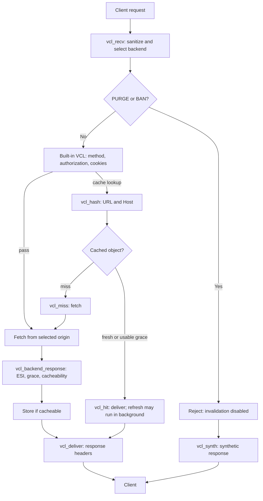

# Varnish Cache configuration guide

A fictional, annotated VCL 4.1 example for routing site, API, and image traffic through Varnish Cache. It illustrates a realistic multi-origin setup without exposing production domains or addresses. [`merged.vcl`](merged.vcl) is a starting point, not a production configuration.

## Request flow



The diagram is a simplified view: pass responses are not stored, and backend errors, retries, hit-for-miss and hit-for-pass have additional paths. GitHub renders Mermaid diagrams directly.

## Getting started

1. Install Varnish and review the documentation for **your installed version**. `vcl 4.1` is a language version, not the Varnish release number.
2. In `merged.vcl`, replace the example origin IPs and ports. Ensure none points back to the Varnish listener. Remove the second site backend from both its declaration and `pool_site` if there is only one site server.
3. Replace the reserved `.invalid` domains and example paths in `request_route`. Confirm that each origin serves the intended Host and content.
4. Optionally enable the probe after confirming its URL returns HTTP 200 on each origin. Set an appropriate Host in a custom probe request if the origin requires one.
5. Compile before loading: `varnishd -C -f merged.vcl`. Run Varnish in a test environment, verify the routes and cache behavior, then load it using your service's normal deployment process.

The sample ports `8080`–`8083`, timeouts and connection limits are examples; tune them with measurements and the origin's capacity. TLS termination and listener settings are outside this VCL.

## How the pieces work

| Piece | Purpose |
| --- | --- |
| `backend_*` | An origin server with an address, port, connection limits and timeouts. |
| `probe_padrao` | Optional health check; enable it and attach it to each applicable backend. Without probes, health-based selection is unavailable. |
| `vcl_init` and `pool_*` | Initialize `directors.round_robin()` pools. Site servers must be interchangeable; `add_backend` makes each a pool member. |
| `request_sanitize` | Removes the inbound `Proxy` header before forwarding. |
| `request_route` | Sets a default backend, then selects the API or image pool when a condition matches. |
| `request_invalidation` | Rejects PURGE and BAN until an invalidation policy is configured. |
| `request_cache_policy` | Advertises ESI support; optional public asset cookie handling is commented out. |
| `vcl_hash`, `vcl_hit`, `vcl_miss` | Provide extension points while leaving the default cache key and hit/miss behavior to built-in VCL. |
| `response_enable_esi` | Enables ESI processing when the backend requests it through `Surrogate-Control`. |
| `response_cache_policy` | Sets six hours of grace and provides disabled examples of public-content TTLs. |
| `response_delivery_headers` | Adds `X-Cache` and removes selected technology headers. |
| `vcl_purge`, `vcl_synth`, `vcl_fini` | Extension points for purge responses, synthetic responses and cleanup. |

VCL is event-driven. `vcl_recv` and the other `vcl_*` hooks are called by Varnish; custom `sub` blocks run when called. If execution reaches the end of a hook without an explicit return, built-in VCL continues. An explicit `return` in a called subroutine changes the enclosing VCL flow too. See the [official VCL guide](https://varnish-cache.org/docs/trunk/users-guide/vcl.html).

### Cache, TTL and grace

By default, built-in VCL determines whether to pass or look up a request and whether a backend response is cacheable. Cookies, authorization, `Set-Cookie`, `Cache-Control` and other headers affect these decisions. The built-in cache key includes URL and Host; different query strings normally mean different objects. See [hashing](https://varnish-cache.org/docs/trunk/users-guide/vcl-hashing.html).

TTL is the fresh lifetime of a cached object. Grace allows a stale object to be served under the applicable Varnish policy while refresh or origin recovery is handled. Setting grace does not make an otherwise uncacheable response cacheable. Inspect the installed version's [grace documentation](https://varnish-cache.org/docs/trunk/users-guide/vcl-grace.html).

The original-style TTL examples are commented out: enable them only for endpoints verified to be public and identical across users. Never remove request cookies or response `Set-Cookie`, or force a shared cache, without understanding personalization. A positive TTL alone does not prove that a response is safe to share. CORS allowlists and preflight should be configured for real origins, with correct `Vary` behavior.

## Operators and precedence

| Operator | Meaning | Example |
| --- | --- | --- |
| `==`, `!=` | Equal / not equal | `req.method == "GET"` |
| `~`, `!~` | Regex or ACL match / does not match | `req.url ~ "^/api/"` |
| `!` | Boolean negation | `!req.http.Authorization` |
| `&&` | Both conditions must be true | `req.method == "GET" && req.url ~ "^/public/"` |
| `||` | Either condition may be true | `req.method == "GET" || req.method == "HEAD"` |
| `=`, `+` | Assignment in `set`, and concatenation/addition where supported | `set beresp.grace = 6h;` |

Use parentheses to make precedence explicit, especially when mixing `&&` and `||`:

```vcl
if (req.url ~ "^/api/" &&
    (req.http.host == "site.example.invalid" ||
     req.http.host == "api.example.invalid")) {
    set req.backend_hint = pool_api.backend();
}
```

This matches `/api/` on either host. Without the inner parentheses, `&&` binds more tightly than `||`, so the second host could match any path. Parentheses also make reviews easier. Strings used with `~` are regular expressions: `^` anchors the start, `$` the end, `[.]` matches a literal dot, and `(?i)` makes a pattern case-insensitive. A URL usually includes its query string; account for it in end-anchored patterns.

Control-flow order matters as much as operator precedence. In an `if` / `elseif` chain, only the first matching branch runs; in separate `if` blocks, a later assignment can override an earlier `req.backend_hint`. `return (hash)`, `return (pass)`, `return (purge)` and `return (synth(...))` end the current processing path; rules after them do not execute. For complete syntax and types, consult the [VCL reference](https://varnish-cache.org/docs/trunk/reference/vcl.html).

## Practical examples

### Add a backend and route a host

Declare an origin and add it to a director in `vcl_init`. Group multiple backends only when they serve equivalent content:

```vcl
backend backend_catalog_01 {
    .host = "127.0.0.1";
    .port = "8090";
}

sub vcl_init {
    new pool_catalog = directors.round_robin();
    pool_catalog.add_backend(backend_catalog_01);
}

sub vcl_recv {
    if (req.http.host ~ "(?i)^catalog[.]example[.]invalid(:[0-9]+)?$") {
        set req.backend_hint = pool_catalog.backend();
    }
}
```

Add these pieces to the corresponding existing blocks rather than duplicating definitions blindly. Route selection does not itself make a response cacheable.

### Check routing and cache

With Varnish listening locally on port 6081 and configured origins available:

```sh
curl -i -H 'Host: site.example.invalid' http://127.0.0.1:6081/public/test.css
curl -i -H 'Host: site.example.invalid' http://127.0.0.1:6081/public/test.css
curl -i -H 'Host: api.example.invalid' http://127.0.0.1:6081/api/example
```

Compare the `X-Cache` headers and origin logs. A second request is not guaranteed to be a HIT: the origin may mark it private or uncacheable, send a cookie, or have a short TTL. Test with different hosts, query strings, cookies and authorization, and check that private responses never leak between users.

### Invalidation

PURGE and BAN return 405 in the template. The commented ACL and PURGE example show where to add trusted IPs. If a proxy is in front, verify which address `client.ip` represents before relying on the ACL. PURGE invalidates the matching cache key; BAN uses separate matching rules and must be designed and restricted independently. Do not expose unrestricted invalidation.

## Validation and performance

Use `varnishd -C -f merged.vcl` with the exact installed release, and test routing, origin health, static content, authenticated requests, ESI, invalidation and stale behavior. Use `varnishtest` for repeatable integration tests and `varnishlog` / `varnishstat` for diagnosis. Benchmark under representative load before changing timeouts, concurrency, cache lifetimes or storage. No performance improvement is guaranteed by this template.

## References

- [Varnish User Guide: VCL](https://varnish-cache.org/docs/trunk/users-guide/vcl.html)
- [VCL reference](https://varnish-cache.org/docs/trunk/reference/vcl.html)
- [Varnish documentation index](https://varnish-cache.org/docs/)
